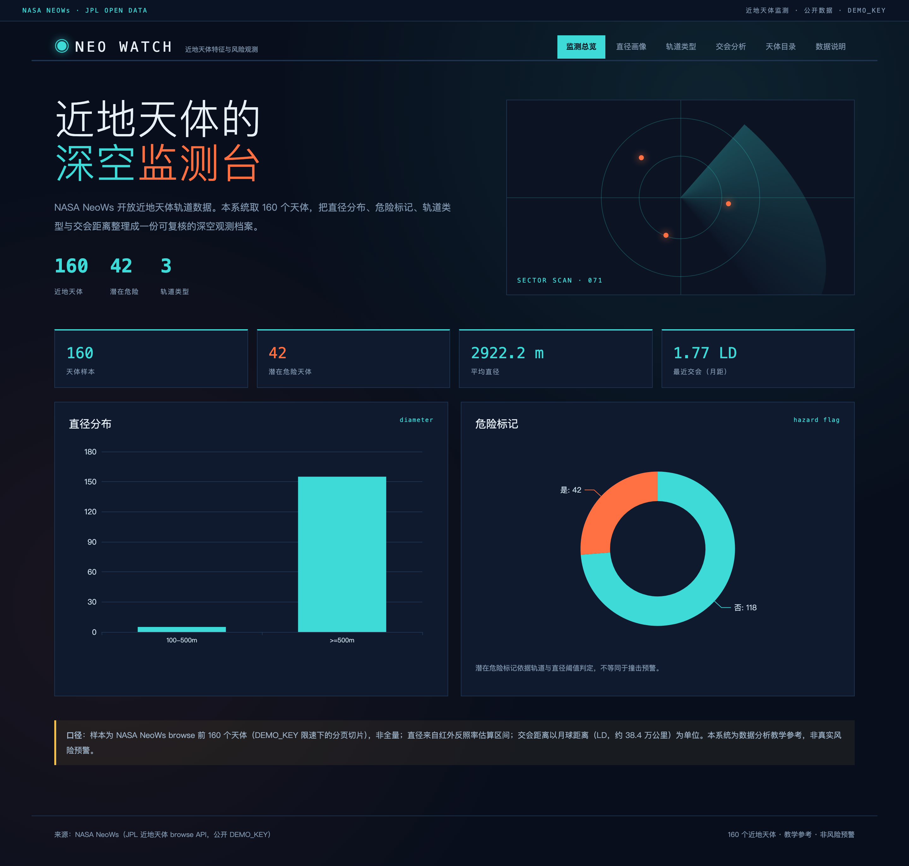
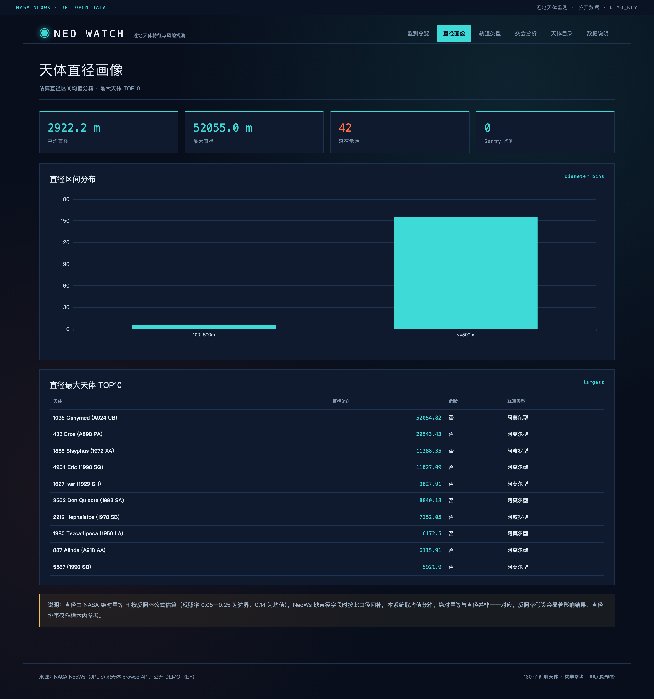
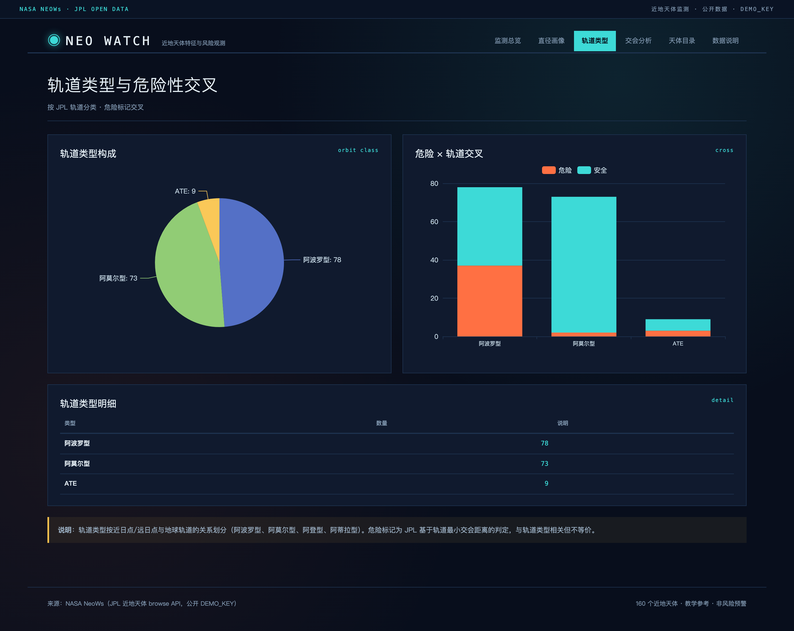
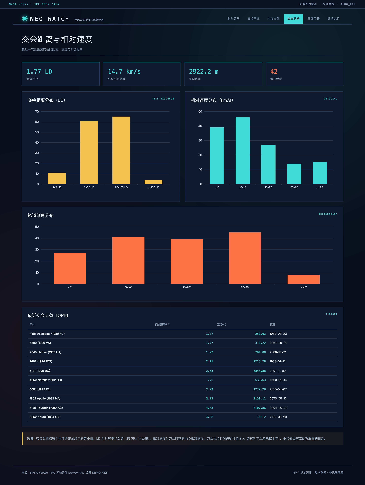
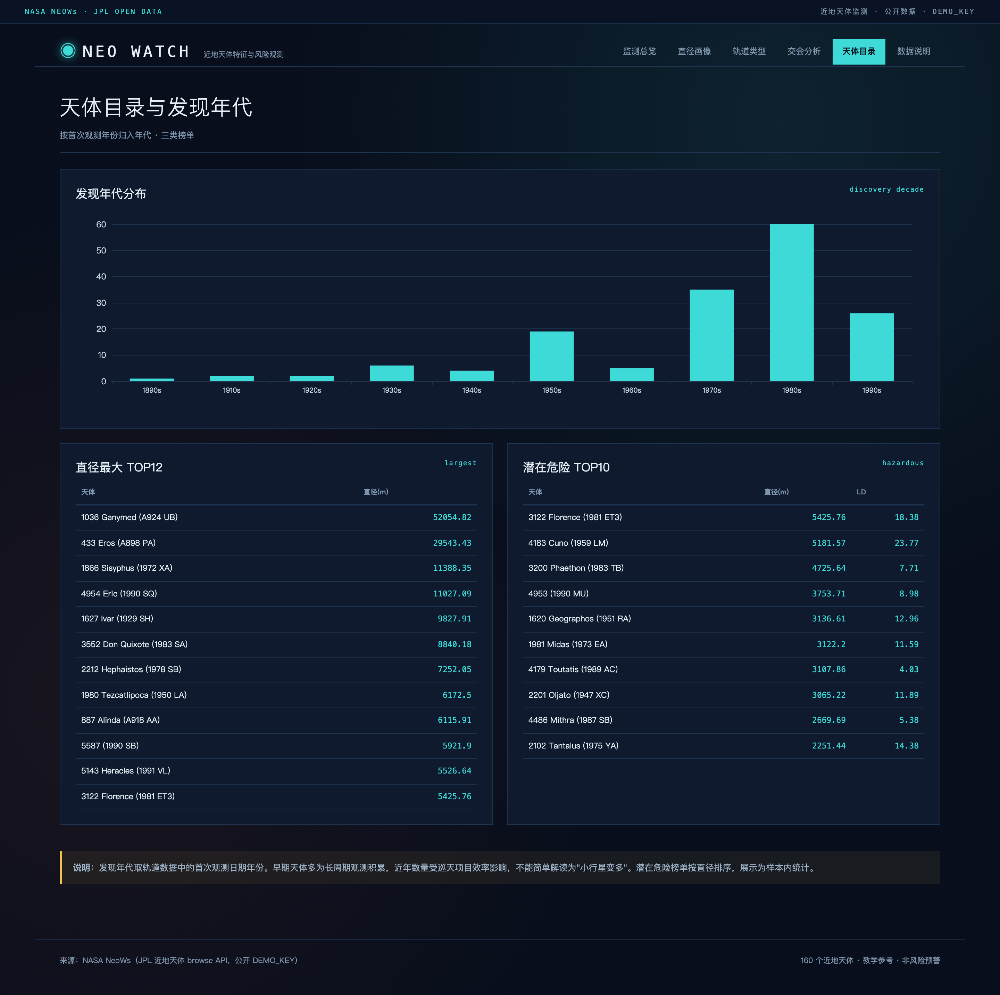
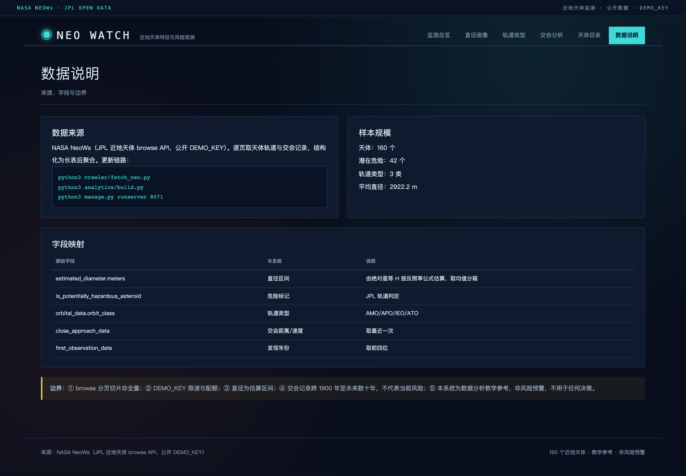

# 071 基于NASA近地小行星开放数据的天体特征与风险分析系统-设计展示

> **代码有偿获取 可接受定制 微信联系方式: csbysj2020 或 ACE2487，备注(BS)**

> **完整源码与全套文档 · 在线自助获取 >>> [https://mbd.pub/o/bread/YZaWmJptbQ==](https://mbd.pub/o/bread/YZaWmJptbQ==)**

> **成品页（功能介绍 / 更多选题）>>> [https://bishe.suilang.net/products/neo-watch](https://bishe.suilang.net/products/neo-watch)**

> 

> 

## 视频

> **点击查看 >>> [https://www.bilibili.com/video/BV1fKyhzyEhQ/](https://www.bilibili.com/video/BV1fKyhzyEhQ/)**

## 项目简介

深空雷达风格（黑蓝、青色扫描、告警橙），区别于影视图鉴/警务档案/台账/街机。采集 NASA NeoWs 公开近地天体 160 个、3 类轨道，从直径、危险标记、轨道与交会四维分析。Django + ECharts（本地化离线可用），6 个页面。分页切片与直径由 H 反照率估算的口径如实标注，非风险预警。

近地天体的直径、轨道与交会参数是天文科普的基础数据。

本项目设计并实现了一套基于 NASA NeoWs 公开数据的近地天体分析系统：通过 browse API 分页获取 160 个天体的轨道与交会记录，结构化后从直径分布、危险标记、轨道类型、交会距离与发现年代五个维度聚合分析。

系统采用 Django + ECharts 与深空雷达式界面（深空黑蓝、青色扫描、告警橙），实现监测总览、直径画像、轨道类型、交会分析、天体目录、数据说明 6 个页面。

本仓库为**设计展示**：包含项目说明、技术架构、实验结果与运行截图；完整源码、任务书、开题报告、毕业论文与使用说明可通过上方链接自助获取，成品页可查看更多选题，也可联系微信咨询定制。

## 功能特性

1. 差异化视觉：深空雷达（黑蓝/青色/告警橙/扫描动画），非看板/画廊/图鉴/档案

2. 真实采集：NASA NeoWs browse API 公开 DEMO_KEY，160 个天体

3. 五维分析：直径/危险标记/轨道类型/交会距离与速度/发现年代

4. 危险画像：42 个潜在危险天体，危险×轨道交叉

5. 交会分析：距离以月球距离(LD)为单位，平均速度 14.7 km/s

6. 天体目录：发现年代 + 直径最大/潜在危险榜单

7. 技术栈差异化：Django + ECharts（本地化）

8. 合规边界：分页切片非全量、直径估算区间、交会时间跨度大，非风险预警

## 技术架构

| 项目 | 说明 |
| --- | --- |
| 编程语言 | Python 3.8+ |
| Web 框架 | Django 4.2 |
| 图表 | ECharts（本地化离线可用） |
| 数据源 | NASA NeoWs（公开 DEMO_KEY） |
| 样本规模 | 160 天体 / 3 轨道类型 |
| 运行端口 | http://127.0.0.1:8071 |
| 说明 | 数据直读 analysis JSON，无需数据库 |

## 目录结构

以下为完整交付版的结构（本仓库仅作设计展示）：

```
neo-watch/
├── analytics/
│   └── build.py
├── crawler/
│   └── fetch_neo.py
├── data/
│   ├── analysis/
│   │   ├── closest.json
│   │   ├── diameter_bins.json
│   │   ├── discovery.json
│   │   ├── hazard.json
│   │   ├── hazard_orbit.json
│   │   ├── hazardous_list.json
│   │   ├── inclination_bins.json
│   │   ├── largest.json
│   │   ├── miss_bins.json
│   │   ├── orbit_classes.json
│   │   └── velocity_bins.json
│   ├── processed/
│   │   └── neo.csv
│   └── stats.json
├── neoapp/
│   ├── __init__.py
│   └── app.py
├── neoproj/
│   ├── __init__.py
│   ├── settings.py
│   ├── urls.py
│   └── wsgi.py
├── static/
│   ├── css/
│   │   └── style.css
│   └── vendor/
│       └── echarts.min.js
├── templates/
│   ├── about.html
│   ├── approach.html
│   ├── base.html
│   ├── catalog.html
│   ├── diameter.html
│   ├── orbit.html
│   └── overview.html
├── 任务书/
└── …
```

## 数据与实验结论

- 实验显示样本中潜在危险天体 42 个，主要轨道类型为 阿波罗型，交会距离跨度从 1.77 个月球距离起。
- 真实采集：NASA NeoWs browse API 公开 DEMO_KEY，160 个天体
- 危险画像：42 个潜在危险天体，危险×轨道交叉
- 交会分析：距离以月球距离(LD)为单位，平均速度 14.7 km/s

## 交付内容

1. 完整源码（Django 应用 + 采集器 + 分析引擎 + 6 页面）
2. 真实数据（neo.csv + analysis JSON）
3. 任务书与开题报告（Word）
4. 毕业论文（Word 七章制）
5. 二次开发说明（Word+md）
6. 6 张截图 + 封面 + 演示视频

## 常见问题

**危险标记意味着会撞地球吗？**

不意味着，那是 JPL 基于轨道参数的判定，非撞击预警。

**直径准吗？**

是红外反照率估算的区间，受假设影响，系统取均值。

**交会距离是最近的未来交会吗？**

是历史记录最小值，跨度 1900 年至未来数十年，不代表当前风险。

**图表能离线用吗？**

能，echarts.min.js 已本地化到 static/vendor/。

## 截图







